<div align="center">

<a href="https://avatar-one-rho.vercel.app">
  
</a>

<br/>

[](https://avatar-one-rho.vercel.app)


**A cinematic, scroll-driven 3D journey through Pandora — five chapters, a mouse-tracking hero and a living gallery.**

</div>

---

## 🎬 3D in motion

<table>
  <tr>
    <td align="center" width="50%">
      <a href="https://avatar-one-rho.vercel.app">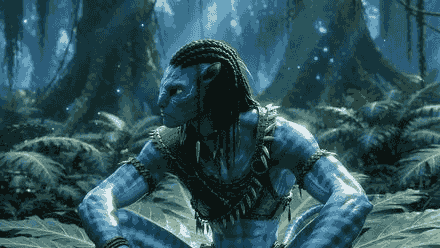</a>
      <br/><sub><b>Hero</b> — the avatar turns in 3D to follow your mouse (181 frames)</sub>
    </td>
    <td align="center" width="50%">
      <a href="https://avatar-one-rho.vercel.app">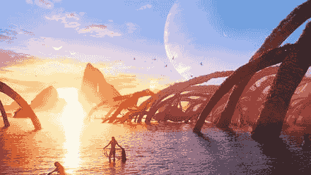</a>
      <br/><sub><b>Chapters</b> — your scroll position scrubs a pinned 3D sequence</sub>
    </td>
  </tr>
</table>

<div align="center">

### 👉 [Open the live demo](https://avatar-one-rho.vercel.app) — move your mouse over the hero, then scroll.

</div>

---

## ✨ Features

| | |
|---|---|
| 🧭 **Five scroll chapters** | Pandora · The Na'vi · Conflict · The Metkayina · Way of Water — each pinned while the scroll scrubs a frame sequence on a canvas, with a 3D text flip-in |
| 👁️ **Mouse-tracking hero** | 181 frames of the avatar turning, driven by the cursor position |
| 🖼️ **Gallery** | Three infinite marquees (one per film) with a full-size lightbox |
| ▶️ **Trailer player** | Official trailers for all three films, switchable in one player |
| 🧷 **Menu & navigation** | Full-screen menu, nav and footer links all smooth-scroll to the right chapter |
| 🧈 **Smooth scrolling** | Lenis + GSAP ScrollTrigger on a shared ticker |

## ⚡ Performance work

The original build stuttered badly while scrolling. Measured in Chrome with real wheel input
on an Intel UHD laptop GPU:

| Stretch | Before | After |
|---|---|---|
| Chapters 1–2 | 9–22 fps | **52 fps** |
| Chapters 2–4 | 15–31 fps | **53 fps** |
| Chapters 4–5 | 9–23 fps | **50 fps** |

What made the difference:

1. **Screen-sized frames** — the 662 chapter frames were 4K JPEGs; they're now 1920 px copies
   (`npm run optimize-images`). Gallery images went from 344 MB of 7K PNGs to 14 MB of WebP.
2. **Decode before you draw** — drawing a fresh `` to a canvas cost ~61 ms per frame. Frames are
   now fetched as blobs and decoded off the main thread into `ImageBitmap`s (~7 ms to draw), kept in a
   sliding window around the current frame so memory stays bounded
   ([`app/lib/frameSequence.ts`](app/lib/frameSequence.ts)).
3. **No main-thread resizing** — `createImageBitmap`'s resize option runs on the main thread in Chrome
   (~130 ms per frame), so bitmaps are decoded at full size and the GPU scales them.
4. **Prioritized loading** — one shared queue downloads the hero first, then chapters in page order,
   and the chapter you're approaching jumps ahead ([`app/lib/frameLoader.ts`](app/lib/frameLoader.ts)).

## 📸 Screenshots

<table>
  <tr>
    <td>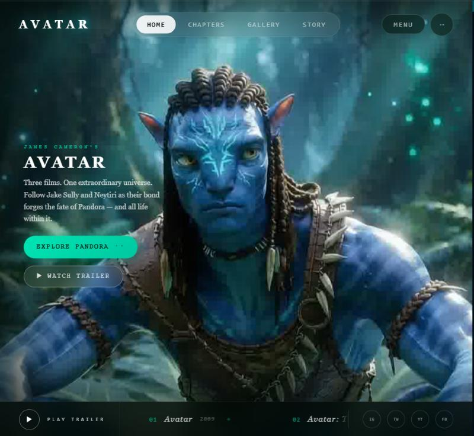<br/><sub>Hero</sub></td>
    <td>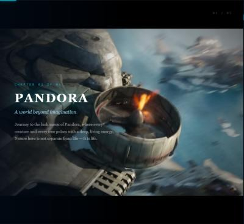<br/><sub>Chapter 01 — Pandora</sub></td>
    <td>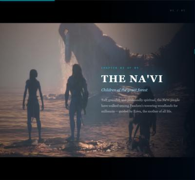<br/><sub>Chapter 02 — The Na'vi</sub></td>
  </tr>
  <tr>
    <td>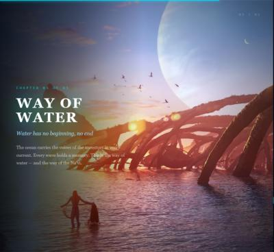<br/><sub>Chapter 05 — Way of Water</sub></td>
    <td>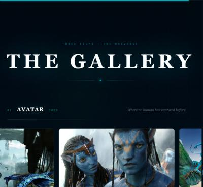<br/><sub>Gallery</sub></td>
    <td>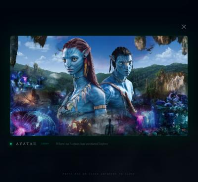<br/><sub>Lightbox</sub></td>
  </tr>
  <tr>
    <td>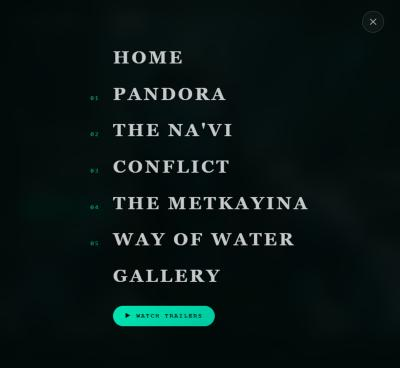<br/><sub>Menu</sub></td>
    <td>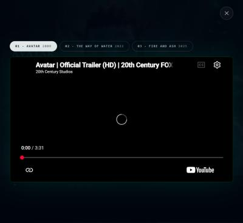<br/><sub>Trailer player</sub></td>
    <td>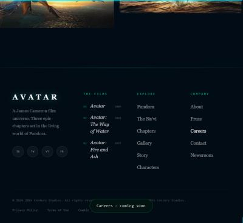<br/><sub>Footer</sub></td>
  </tr>
</table>

## 🤖 Built with Claude Code

The whole session — setup, debugging, the performance work and deployment — was driven by prompts in
Claude Code. Every prompt, with what it produced, is in **[docs/PROMPTS.md](docs/PROMPTS.md)**.

## 🛠️ Run it locally

Requires Node.js 24+.

```bash
npm ci
npm run dev
```

Open http://localhost:3000.

> The full-resolution originals (4K frames, 7K gallery PNGs, ~450 MB) are not in this repository —
> only the screen-sized copies in `public/optimized/` that the site actually loads. If you add the
> originals back into `public/`, `npm run optimize-images` regenerates the copies (it also runs
> automatically before `dev` and `build`).

Other scripts:

| Command | What it does |
|---|---|
| `npm run build` | Production build |
| `npm run optimize-images` | Regenerate `public/optimized/` from the originals |
| `node scripts/make-readme-media.mjs` | Rebuild the README GIFs |

## 🚀 Deploy

Deployed on Vercel as a Next.js project:

```bash
npx vercel@65.10.0 deploy --prod
```

## 📁 Project structure

```
app/
  page.tsx                 page layout, Lenis setup, footer
  components/
    Hero.tsx               mouse-tracking 3D hero
    FrameSection.tsx       pinned, scroll-scrubbed chapter
    GallerySection.tsx     marquees + lightbox
    Overlays.tsx           menu, trailer player, toasts
    Loader.tsx             intro animation
  lib/
    frameLoader.ts         prioritized frame downloads
    frameSequence.ts       off-thread decoding, sliding ImageBitmap window
    scroll.ts              shared smooth-scroll + scroll lock
    ui.ts                  trailers, social links, UI events
scripts/                   image optimization + README media
public/optimized/          screen-sized frames and gallery images
docs/                      prompts, screenshots, README media
```

## 🙏 Credits

- Based on [alagappan567/avatar](https://github.com/alagappan567/avatar).
- **Unofficial fan project.** *Avatar* and all film imagery and trailers are the property of
  20th Century Studios / Lightstorm Entertainment. This repository is not affiliated with or endorsed by them.
